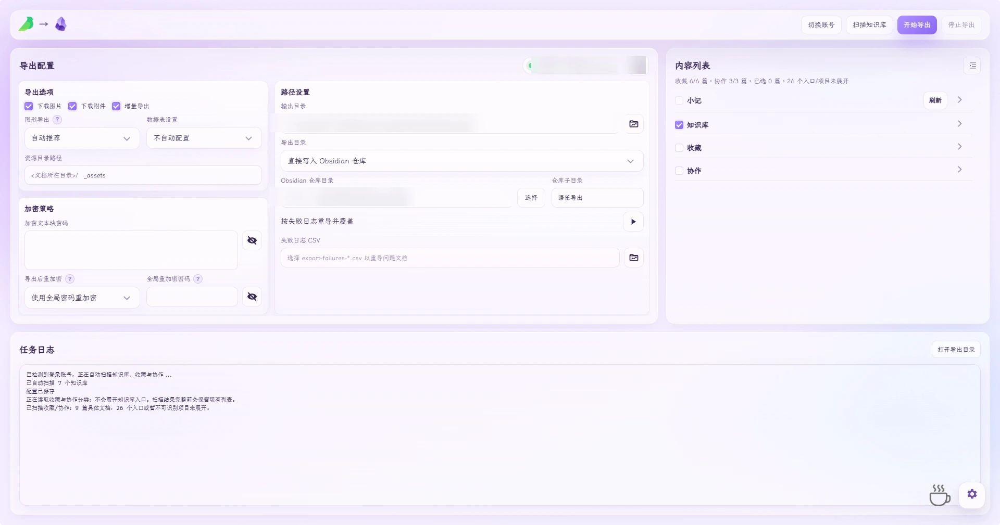

# 语雀 → Markdown / Obsidian 导出器

[](./LICENSE)
[](./COMMERCIAL-LICENSE.md)
[](https://nodejs.org)
[](#环境要求)

将语雀的知识库、文档与小记导出为 Markdown，输出可直接归档、可被 Obsidian 直接索引的本地资料。

> **非官方项目**
> 本项目是独立社区工具，与语雀、Obsidian 及其运营方**没有任何官方关联、合作或背书**。
> 请仅用于导出**你自己账号有权访问**的内容；导出他人或团队内容前请确认已获授权。



> 截图中已对账号名与本机路径做模糊处理。

## 这是什么

语雀没有提供完整的 Markdown 批量导出能力，尤其是数据表、画板、电子表格、小记这类结构化内容。
本项目通过桌面端驱动完成登录与抓取，把这些内容转换成**本地可长期保存、可版本管理、可被 Obsidian 直接识别**的 Markdown 与其资源文件。

适合这些场景：

- 想把自己的语雀笔记整体迁到 Obsidian 或本地目录长期归档
- 需要定期增量导出，而不是一次性搬运
- 需要保留图片、附件、表格、画板的原始结构，而不是导出成纯文本

## 功能

- 桌面端登录、扫描知识库、树形选择整个知识库或单篇文档
- 小记按标签分组导出：首个标签存正文、其他标签生成索引，保留时间与可读摘要
- 支持图片/附件下载与相对路径重写，导出后链接可直接打开
- 失败日志 CSV、失败记录单独重导、增量导出、暂停后继续
- 数据表、电子表格、画板与复杂块的结构化导出，结构不完整时自动降级兜底
- Obsidian 仓库直写、资源目录整理
- Windows EXE 打包脚本，以及手工运行时验证工具

## 环境要求

- Windows 10 / 11
- Node.js 22.12 或更新版本（Puppeteer 25 的要求）
- Python 3.11 或更新版本
- 首次运行需要能访问语雀，并在弹出的浏览器窗口中完成登录

## 快速开始

```powershell
git clone https://github.com/baimoushare/yuque2obsidian.git
cd yuque2obsidian

npm install

python -m venv .venv
.\.venv\Scripts\python.exe -m pip install -r requirements.txt

.\.venv\Scripts\python.exe .\desktop_app.py
```

四步含义：装前端与抓取依赖 → 建独立 Python 环境 → 装桌面端依赖 → 用**该环境**启动桌面程序。

注意：`npm run desktop` 调用的是系统 Python（`py`），不会使用 `.venv`，容易因缺少 `pywebview` 启动失败。请按上面最后一条显式使用 venv 解释器；若你已把 `pywebview` 装进系统 Python，则 `npm run desktop` 也可用。

**国内网络提示**：`npm install` 会下载 Chromium，容易超时。可先设置镜像再安装：

```powershell
$env:PUPPETEER_DOWNLOAD_BASE_URL="https://cdn.npmmirror.com/binaries/chrome-for-testing"
npm install
```

## 使用流程

1. 启动后完成语雀登录，程序会保存登录态
2. 扫描知识库，在树形列表中勾选要导出的知识库、文档或小记
3. 选择输出目录，或直接指向 Obsidian 仓库
4. 开始导出，结束后查看结果与失败日志 CSV
5. 有失败项时，用失败 CSV 单独重导，不需要整体重跑

## 运行测试

```powershell
npm test
.\.venv\Scripts\python.exe -m unittest discover -s test -p 'test_*.py'
```

## 打包 Windows EXE

```powershell
npm run build:exe
```

打包脚本会从当前机器定位 Node.js 并作为运行时文件带入 EXE，**不会**把登录 Cookie 或个人桌面配置打进产物。

如已配置 Windows 代码签名证书，可把证书指纹写入环境变量 `YUQUE_CODE_SIGN_CERT_THUMBPRINT`，脚本会调用 `signtool.exe` 签名并验证。无证书时仍会生成含 SHA-256 的 `release/manifest.json`，但 Windows 不会显示受信任发布者。

## 目录结构

- `desktop/`：桌面端界面资源
- `src/`：Node.js 导出内核与语雀内容处理逻辑
- `test/`：Node.js 与 Python 自动化测试
- `tools/`：探测脚本与 OTA 发布工具
- `images/`：README 演示素材
- `desktop_app.py`：桌面程序入口
- `desktop_retry.py`：失败日志重导辅助逻辑
- `desktop_update.py`：OTA 自动更新
- `build_windows_exe.ps1`：Windows 打包脚本
- `YuqueExporterObsidian.spec`：PyInstaller 配置

以下属于本地运行或构建产物，**不进入版本库**：
`output/`、`release/`、`runtime-validation/`、`.yuque-login-profile/`、`cookies.json`、`desktop.settings.json`、`crash-reports/`、`*.log`。

项目的设计文档与内部交接记录**不随公开仓库发布**，避免把本机路径与个人环境信息带入公开历史。

## 登录态与隐私

- 登录 Cookie 默认保存在 `%LOCALAPPDATA%\YuqueExporterObsidian\cookies.json`，Windows 下由当前用户 DPAPI 保护
- 浏览器登录资料保存在用户数据目录下的 `.yuque-login-profile/`
- `desktop.settings.json` 只保存普通导出选项；加密块密码仅在本次任务内存中使用，不落盘
- 发布脚本不会把 Cookie 或个人配置打进 EXE
- **分享前请自行检查** `release/`、日志与导出内容
- 导出的语雀内容可能包含个人、团队或受版权保护的信息，分享前请确认你拥有相应授权

本项目**不上传**你的笔记内容到任何第三方服务；所有抓取与转换都在本机完成。

## 已知限制

- 语雀页面结构或接口调整后，部分导出功能可能需要同步修改，**不承诺及时跟进**
- 复杂画板、数据表与特殊块会按结构完整度选择 Mermaid、Excalidraw、附件或 PNG 等输出形式，个别情况只能降级
- 可导出范围取决于当前登录账号的权限
- 仅支持 Windows；其他平台未验证

## 常见问题

**安装时 Chromium 下载失败？**
设置 `PUPPETEER_DOWNLOAD_BASE_URL` 指向国内镜像后重装，见「快速开始」。

**导出后图片打不开？**
确认导出时勾选了图片下载，且没有手动移动过 `assets` 或附件目录；相对路径依赖原始目录结构。

**某篇文档导出为空或结构错乱？**
多为加密块或语雀新块类型。查看失败日志 CSV，并把块类型反馈到 Issue（**不要附正文内容**）。

**升级后接口失效？**
语雀接口变更属于预期风险。可先在 Issue 中搜索是否已有同类报告。

**能不能在 macOS / Linux 上用？**
当前未适配，桌面壳依赖 Windows 特性。

## 开源许可

本项目采用 **AGPL-3.0 + 商业授权** 双许可模式：

- **个人、学习、内部使用**：免费，遵循 [GNU AGPL-3.0](./LICENSE)
- **商业闭源集成或对外提供闭源服务**：需取得[商业授权](./COMMERCIAL-LICENSE.md)
- 愿意把衍生代码同样以 AGPL-3.0 开源的商业使用，同样免费

简单说：**免费用可以，拿它做闭源商业产品需要授权。**

本项目为独立实现，版权归项目维护者所有。功能设计阶段参考过
[renyunkang/yuque-exporter](https://github.com/renyunkang/yuque-exporter)（GPL-2.0），
但**不包含其代码**，与其不存在衍生或补充关系，特此致谢。

第三方组件按各自许可证分发，见 [THIRD-PARTY-NOTICES.md](./THIRD-PARTY-NOTICES.md)。
Yuque 与 Obsidian 是各自权利人的商标，本项目仅作兼容性说明使用。

## 参与贡献

提交前请阅读 [CONTRIBUTING.md](./CONTRIBUTING.md)。提交代码即表示你同意以 AGPL-3.0 授权你的贡献，
并允许维护者以商业授权方式再许可（双许可模式所需）。

## 反馈与安全

- 功能建议与缺陷：请提交 [Issue](https://github.com/baimoushare/yuque2obsidian/issues)
- 安全问题：请勿公开提交，按 [SECURITY.md](./SECURITY.md) 的渠道报告
- 提交 Issue 前请删除 **Cookie、登录资料、真实导出内容、个人路径** 等敏感信息

---

## English

A Windows desktop tool that exports Yuque (语雀) knowledge bases, documents, and notes into local Markdown
plus assets, designed for archiving and for direct use in Obsidian.

**Highlights**: desktop login and tree-based selection, incremental export, resumable runs,
failure-log CSV with targeted retry, and structured export (with graceful fallback) for tables,
spreadsheets, and whiteboards.

**Requirements**: Windows 10/11, Node.js ≥ 22.12, Python ≥ 3.11. See [Quick Start](#快速开始).

**License**: dual-licensed under [AGPL-3.0](./LICENSE) for open-source use, with a
[commercial license](./COMMERCIAL-LICENSE.md) available for closed-source commercial use.

**Disclaimer**: This is an independent community project. It is not affiliated with, endorsed by,
or sponsored by Yuque or Obsidian. Use it only for content you are authorized to access.
